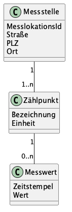

# Musterlösung zu Aufgabe 1: Messstellen und Zählpunkte

Schauen Sie hier erst hinein, wenn Sie die Aufgabe **selbst** gelöst haben.

Quelltext des Diagramms: `aufgabe1-messstellen.puml` (PlantUML).

## Klassen und Attribute

| Klasse | Attribute |
|---|---|
| Messstelle | MesslokationsId, Straße, PLZ, Ort |
| Zählpunkt | Bezeichnung, Einheit |
| Messwert | Zeitstempel, Wert |

## Assoziationen und Multiplizitäten

| Assoziation | Multiplizität | Begründung aus dem Text |
|---|---|---|
| Messstelle – Zählpunkt | 1 zu 1..n | „ein oder mehrere Zählpunkte“, „gehört immer zu genau einer Messstelle“ |
| Zählpunkt – Messwert | 1 zu 0..n | „beliebig viele Messwerte“, „gehört zu genau einem Zählpunkt“ |

## Typische Fragen

- **Adresse als eigene Klasse?** Ebenfalls richtig: eine Klasse *Adresse* (Straße, PLZ, Ort), mit der die Messstelle über eine 1-zu-1-Assoziation verbunden ist. Das lohnt sich, sobald auch andere Klassen eine Adresse brauchen.
- **Einheit am Messwert?** Nicht nötig: Alle Messwerte eines Zählpunkts haben dessen Einheit. Am Messwert wäre sie redundant.
- **Komposition statt Assoziation?** Inhaltlich passt eine Komposition (ein Messwert existiert nicht ohne seinen Zählpunkt). Die Aufgabe verlangt aber ausdrücklich nur Assoziationen.
