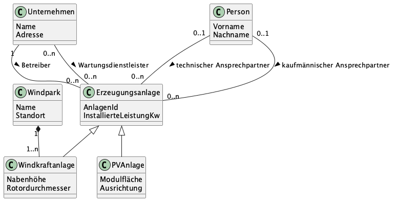

# Musterlösung zu Aufgabe 2: Erzeugungsportfolio

Schauen Sie hier erst hinein, wenn Sie die Aufgabe **selbst** gelöst haben.

Quelltext des Diagramms: `aufgabe2-erzeugungsportfolio.puml` (PlantUML).

## Vererbung

Windkraftanlagen und PV-Anlagen haben gemeinsame Attribute (AnlagenId, installierte Leistung) und jeweils eigene. Die gemeinsamen Attribute stehen in der Basisklasse *Erzeugungsanlage*, die speziellen in den Kindklassen *Windkraftanlage* und *PVAnlage*.

Alle Assoziationen zu Betreiber, Wartungsdienstleister und Ansprechpartnern hängen an *Erzeugungsanlage* und gelten damit für beide Anlagenarten.

## Komposition beim Windpark

Hier passt die **Komposition** (gefüllte Raute am Windpark):

- Laut Szenario werden die Anlagen ohne den Windpark im System „nicht separat verwaltet“.
- Damit hängt die Lebensdauer der Windkraftanlage im System an der des Windparks.

Die Vorlesung zeigt beide Fälle: Kann eine Windkraftanlage auch als Einzelanlage existieren, ist es eine **Aggregation**. Verwaltet das System sie nur als Teil eines Windparks, wie hier, ist es eine Komposition. Entscheidend ist, was das konkrete Szenario festlegt.

## Betreiber und Wartungsdienstleister: Rollen statt Unterklassen

Betreiber und Wartungsdienstleister sind beide *Unternehmen* mit Name und Adresse. Sie werden als **zwei Assoziationen mit Rollennamen** zwischen *Unternehmen* und *Erzeugungsanlage* modelliert:

| Rolle | Multiplizität Unternehmen – Anlage | Begründung |
|---|---|---|
| Betreiber | 1 zu 0..n | genau ein Betreiber je Anlage, ein Betreiber betreibt ggf. mehrere Anlagen |
| Wartungsdienstleister | 0..n zu 0..n | optional, mehrere Dienstleister je Anlage und mehrere Anlagen je Dienstleister möglich |

Unterklassen *Betreiber* und *Wartungsdienstleister* sind schwächer: Dasselbe Unternehmen kann für eine Anlage Betreiber und für eine andere Wartungsdienstleister sein. Mit Unterklassen bräuchte man dafür zwei Objekte für ein Unternehmen.

## Ansprechpartner: zwei Rollen einer Person

Wie im Beispiel *Seminarverwaltung* aus der Vorlesung gibt es **zwei getrennte Assoziationen** zwischen *Person* und *Erzeugungsanlage*, eine je Rolle (technischer und kaufmännischer Ansprechpartner). So kann dieselbe Person über beide Assoziationen mit derselben Anlage verbunden sein, und die Rollen bleiben unterscheidbar.

Ein einzelnes Attribut *Art* an einer einzigen Assoziation reicht dafür nicht. In einem einfachen Klassendiagramm ohne Assoziationsklasse wäre dann nicht festgehalten, in welcher Rolle die Person gerade auftritt.

Die Multiplizitäten (hier 0..1 Ansprechpartner je Rolle und Anlage) lässt das Szenario offen. Andere begründete Werte sind ebenfalls richtig.
