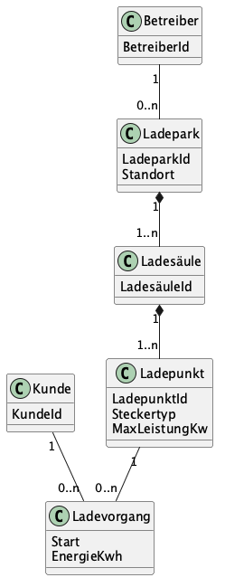

# Musterlösung zu Aufgabe 4: Ein fremdes Datenmodell

Schauen Sie hier erst hinein, wenn Sie die Aufgabe **selbst** gelöst haben.

## 1. Abgeleitetes Klassendiagramm

Quelltext des Diagramms: `aufgabe4-ladepark.puml` (PlantUML).

| Klasse | Attribute | Herkunft im JSON |
|---|---|---|
| Ladepark | LadeparkId, Standort (Straße, PLZ, Ort) | Wurzelobjekt |
| Ladesäule | LadesäuleId | Array `ladesaeulen` |
| Ladepunkt | LadepunktId, Steckertyp, MaxLeistungKw | Array `ladepunkte` |
| Ladevorgang | Start, EnergieKwh | Objekt `aktuellerLadevorgang` |
| Betreiber | BetreiberId | nur Kennung `betreiberId` |
| Kunde | KundeId | nur Kennung `kundeId` |

Der *Standort* ist ein eingebettetes Objekt ohne eigene Kennung. Er kann als Attribut oder als eigene Klasse *Adresse* modelliert werden.

Die Multiplizitäten sind aus **einem** Beispiel abgeleitet und damit Annahmen. Ein Array mit nur einem Eintrag (`ladesaeulen`) deutet auf 1..n hin, beweist es aber nicht.

## 2. Komposition oder Assoziation über eine Kennung?

Hinweise auf eine **Komposition** bei `ladesaeulen` und `ladepunkte`:

- Die Teile stehen vollständig **innerhalb** des Ganzen, mit allen Attributen.
- Ihre Kennungen bauen auf der Kennung des Ganzen auf: `LS-042-01` gehört zu `LP-042`, `LP-042-01-A` zu `LS-042-01`. Ohne das Ganze ergibt die Kennung kaum Sinn.

Hinweise auf eine **Assoziation über eine Kennung** bei `betreiberId` und `kundeId`:

- Es steht nur eine Kennung im Dokument, keine Attribute des Objekts.
- Betreiber und Kunde existieren unabhängig vom Ladepark: Ein Betreiber hat viele Ladeparks, ein Kunde lädt an vielen Ladepunkten. Ihre Daten werden in einem anderen System gepflegt.
- Die Betreiberkennung hat das Format einer 13-stelligen Marktpartner-ID, also eine von außen vergebene Kennung.

## 3. Bruch im Stil beim Ladevorgang

Der Ladevorgang verweist per `ladepunktId` auf einen Ladepunkt, der im selben Dokument schon verschachtelt steht. Mögliche Erklärungen:

- **Andere Art von Daten:** Ladesäulen und Ladepunkte sind Stammdaten (ändern sich selten), ein Ladevorgang ist ein Bewegungsdatum (ändert sich laufend). Vermutlich kommen beide aus unterschiedlichen Teilsystemen und wurden für den Export zusammengefügt.
- **Vermeidung von Redundanz:** Den Ladepunkt im Ladevorgang erneut vollständig zu verschachteln, würde ihn doppelt ins Dokument schreiben.
- **Historisch gewachsen:** `aktuellerLadevorgang` sitzt am Ladepark, gehört fachlich aber zu einem Ladepunkt. Ein Ladepark mit mehreren Ladepunkten kann gleichzeitig mehrere Ladevorgänge haben, das Feld erlaubt aber nur einen. Das spricht für ein Feld, das nachträglich ergänzt wurde.

Fachlich sauberer wäre ein Ladevorgang **am Ladepunkt** (0..1 aktueller Ladevorgang je Ladepunkt) oder eine eigene Liste von Ladevorgängen mit Referenz auf den Ladepunkt.

## 4. Offene Fragen an den Betreiber

Beispiele, mehrere Antworten sind richtig:

- Gibt es pro Ladepark immer nur einen aktuellen Ladevorgang oder einen je Ladepunkt?
- Welche Felder sind Pflicht, welche optional? Gibt es Ladeparks ohne Ladesäulen?
- Welche Werte sind für `steckertyp` zulässig (Codeliste)?
- Was ist `energieKwh` genau: bisher geladene Energie, Zählerstand, abgerechnete Menge?
- Wie endet ein Ladevorgang (Endezeitpunkt, Status), und wo stehen vergangene Ladevorgänge?
- Welche Daten gehören zu Betreiber und Kunde, und aus welchem System kommen sie?
- Hat ein Ladepunkt einen Status (frei, belegt, gestört) oder einen Zähler?
- Sind alle Zeitangaben in UTC?
